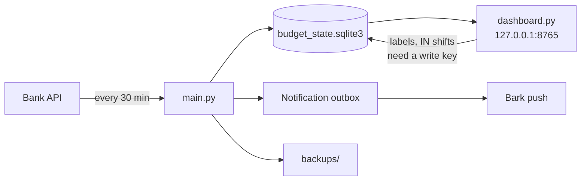

**English** | [Tiếng Việt](README.vi.md)

# Real-time Budget Management

A self-hosted personal budget monitor. It polls a bank transaction API every 30 minutes, stores everything in a local SQLite file, compares your spending with a monthly budget, sends push alerts through [Bark](https://github.com/Finb/Bark), and serves a local-only calendar dashboard.

It is built for one person on one machine. There is no cloud service, no account system and no build step. The only runtime dependency is `python-dotenv`.

> **Language note.** The dashboard, notifications and log messages are in Vietnamese, and the code targets a Vietnamese bank-history API. The documentation is available in English and Vietnamese.

## Features

| Area | What it does |
|---|---|
| **Sync** | Fetches outgoing (OUT) and incoming (IN) transactions every 30 minutes. A failed fetch is retried twice, 5 seconds apart, before the cycle counts as failed. Each request has a 60-second deadline and a 1 MiB response cap. |
| **Storage** | One SQLite file. The first run only records a baseline and sends nothing. If the bank later changes the date or amount of a stored transaction, the stored copy is kept and you get an alert to review it. |
| **Budget** | Set a monthly budget in `.env`; it is split evenly over the days. After a month ends, the money that actually came in (IN) replaces the forecast for that month. |
| **Notifications** | Daily spending notifications, "near budget" and "over budget" alerts, weekly summaries, and an alert when syncing keeps failing. Everything goes through a durable outbox, so nothing is lost when the network is down. |
| **Dashboard** | Month calendar, month summary, cumulative chart, comparison with the previous month, spending by category, search, per-day detail and operational status. |
| **Categories** | Group spending by keywords from `categories.json`, or label a transaction by hand in the dashboard. |
| **Backups** | Daily integrity-checked snapshots, last 7 kept, with a restore command. |
| **Operations** | Status report, outbox inspection and quarantine, conflict review, history reconciliation and a preflight check. |



## Requirements

- Python 3.11 or later.
- A transaction-history API key. The code calls the `thueapibank.vn` transaction-history endpoint (`historyapimbv2`, see `main.py`). Adapting it to another provider means changing the request and the response parsing in `main.py`.
- A Bark device key for push notifications.
- Developed and used on Windows. The file locks also have a POSIX branch (`fcntl`), which is less tested.

## Quick start

```powershell
python -m venv .venv
.\.venv\Scripts\Activate.ps1
python -m pip install -r requirements.txt
if (-not (Test-Path -LiteralPath .env)) { Copy-Item -LiteralPath .env.example -Destination .env }
```

Edit `.env` and fill in your own values. Never commit it.

| Variable | Required | Meaning |
|---|---|---|
| `BANK_KEY` | Yes | Bank API key. |
| `DEVICE_KEY` | Yes | Bark device key. |
| `BUDGET_PERMONTH` | Yes | Budget for one month, in VND, as a non-negative integer. Restart the monitor after changing it; the new value applies from tomorrow. |
| `BUDGET_ALERT_PERCENT` | No | "Near budget" threshold for the daily budget, 1 to 99. Default `80`. |
| `NOTIFICATION_MODE` | No | `all` (default) notifies on every new expense. `thresholds` notifies only when a threshold is reached or exceeded. |
| `ICON_URL`, `BARK_SOUND` | No | Bark notification icon and sound. |
| `DASHBOARD_WRITE_KEY` | No | Turns on dashboard edits. Use a random string of at least 16 characters. |

Run it:

```powershell
python -B main.py --preflight    # startup checks, no API calls
python main.py                   # run the monitor; Ctrl+C stops it
python dashboard.py              # dashboard at http://127.0.0.1:8765
python dashboard.py --port 8766  # use another port
```

Only one monitor can run per database. A leftover `budget_state.sqlite3.lock` file after a stop is normal; do not delete it.

### Operations commands

| Command | Effect |
|---|---|
| `--status` | Sync state, the six processing steps, the notification queue and the latest backup. Read-only. |
| `--outbox-list [--after-id ID] [--limit N]` | List notification outbox events. Read-only. |
| `--outbox-quarantine ID`, `--outbox-release ID` | Hold or release one event. Needs `--confirm --reason "..."`. |
| `--list-conflicts` | List transactions whose date or amount the bank changed. Read-only. |
| `--accept-conflict TRANSACTION_ID` | Accept the bank's new date and amount. Needs `--confirm --reason "..."` (200 characters at most). |
| `--reconcile-history` | Record that you verified the transaction history is complete. Needs `--confirm --reason "..."`. |
| `--self-check` | Offline self-check. |

## How the budget works

- **Forecast budget.** `BUDGET_PERMONTH` split evenly over the days of the month. For a month with `n` days: `q, r = divmod(amount, n)`; the first `r` days get `q + 1`, the others get `q`.
- **Actual budget.** The IN transactions of a month, minus any you chose to count for the next month, plus any carried from the previous month, split the same way.
- **Effective budget.** This is what the calendar, the "Over" flag and the weekly reports use. A running month uses the forecast. Once a month has ended (from day 1 of the next month), it uses the actual budget, if IN tracking covers that month.
- **Daily alerts and notifications** always use the forecast.
- IN is tracked from the month the monitor first records it. Earlier months show "not tracked" and keep the forecast.

## Dashboard

Run `python dashboard.py` and open `http://127.0.0.1:8765`. The dashboard listens only on your machine and reads the database, except for two write actions that need the write key.

- **Today:** spent, forecast budget, remaining, money in.
- **Month summary:** remaining for the month, spendable per day, recorded spending, month budget, highest-spending day, money in.
- **Charts and tables:** cumulative spending and budget, comparison with the previous month, spending by category, and search by note, date, amount, label or category.
- **Calendar:** each day shows spending (with a minus sign, red) and money in (with a plus sign, green). Days over budget carry an "Over" tag.
- **Day detail:** the day's expenses and IN transactions, sorted by time or amount.
- **Technical details:** sync state, notification queue and latest backup.

With `DASHBOARD_WRITE_KEY` set, you enter the key on the page and can **label** an expense or **count an IN transaction for the next month**. Every edit is written to an audit table.

## Categories

Each expense is grouped when it is read. Priority: your manual label, then the first group with a keyword in the bank note, then `Chưa phân loại` (uncategorized). Groups do not change totals, budgets or alerts.

```json
{"groups": [
  {"name": "Tuition", "keywords": ["HOC PHI"]},
  {"name": "Wallet top-up", "keywords": ["cashin", "bank2wallet", "zalopay"]}
]}
```

- Keywords ignore case and accents and must match whole words.
- When several groups match, the one listed first wins.
- E-wallet notes usually carry only transaction codes, not merchant names. Use those codes as keywords.
- Edits apply immediately. If you save an invalid file, the dashboard keeps the previous rules.

## Notifications

- **Daily:** controlled by `NOTIFICATION_MODE`. A "near budget" alert fires when today's spending reaches `BUDGET_ALERT_PERCENT` of the daily budget, and an "over budget" alert fires when it exceeds it.
- **Weekly summary:** sent when a week (Monday to Sunday) ends. If that week's spending changes afterwards, a correction is sent. A change in budget or history flags alone sends nothing.
- **Sync health:** one alert after 3 failed cycles in a row, or after a failed cycle when the last success is over an hour old. When syncing recovers, the incident is closed without a notification.
- **Bank changes:** one notification for each changed date or amount of a stored transaction.
- Delivery is at-least-once, so Bark can receive a duplicate if the process stops at the wrong moment.

## Backup and restore

After each successful write cycle, the monitor refreshes `backups/budget-YYYY-MM-DD.sqlite3` (date in UTC+07:00) when there are new transactions, when today's file is missing, or when it is more than 6 hours old. A label or IN shift made in the dashboard can therefore be missing from the snapshot for up to 6 hours.

```powershell
python -m storage.db_backup backup
python -m storage.db_backup restore backups\budget-2026-10-13.sqlite3 budget_state-restored.sqlite3
```

Restore writes a new file that must not exist yet. Stop the monitor before you replace `budget_state.sqlite3` with it.

## Security and privacy

- `.gitignore` keeps `.env`, the database, `backups/` and `logs/` out of Git. It does not encrypt them and does not untrack files Git already tracks.
- **The database and backups contain transaction notes**, which can include recipient names and account numbers. They are not encrypted. If the folder is inside OneDrive or another sync service, they are uploaded. Do not share them.
- The dashboard binds to `127.0.0.1` and checks Host, Origin and a custom API header. **Never expose its port to a LAN, the internet or a reverse proxy.** For remote access, use RDP or an SSH tunnel such as `ssh -L 8765:127.0.0.1:8765 user@host`.
- Logs redact API keys before writing.

## Limitations

- The bank API returns only a recent window of transactions. At 50 or more, the monitor warns that it may have hit the limit. Totals cover recorded transactions, not the full bank history.
- Categories and labels are for viewing only. There is no way yet to exclude a transaction from totals or budgets, so money that passes through the account (for example tuition paid by a relative) counts as both spending and income.
- Alerts run only while the monitor runs. Nothing watches the monitor itself.
- Dashboard tooltips (definitions on the month cards) do not appear on touch screens.
- The automated test suite is not part of this repository.

## Project layout

| Path | Role |
|---|---|
| `main.py` | The monitor (runs forever) and the operations commands. |
| `dashboard.py`, `dashboard/` | The local dashboard server and its HTML, CSS and JavaScript. |
| `categories.py`, `categories.json` | The keyword categorizer and your keyword file. |
| `ledger_edits.py` | Audited edits: labels, IN shifts, accepting a bank change. |
| `common.py` | Shared constants and helpers. |
| `budget/` | Budget history, effective budget, income and actual budget. |
| `notifications/` | Daily alerts, weekly reports and the durable outbox. |
| `monitoring/` | Sync and step status, health alerts, preflight, logging, history health. |
| `storage/` | Backup and restore, file and single-instance locks. |
| `docs/REFERENCE.md` | Detailed technical reference (in Vietnamese). |

## Disclaimer

This is a personal project. It is not affiliated with any bank or with the API provider. Treat its totals as a convenience, not as a statement of record.

## License

No license has been chosen yet. Until one is added, all rights are reserved.
