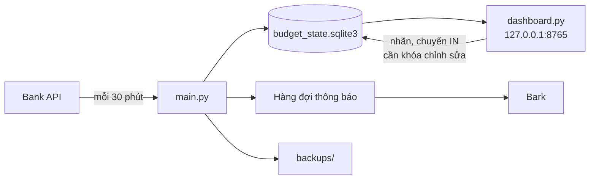

[English](README.md) | **Tiếng Việt**

# Real-time Budget Management

Theo dõi chi tiêu cá nhân gần thời gian thực. Chương trình lấy giao dịch ngân hàng qua API mỗi 30 phút, lưu vào SQLite trên máy bạn, so với ngân sách, gửi thông báo qua Bark và hiển thị trên một dashboard cục bộ.

Tài liệu này là tổng quan. Chi tiết kỹ thuật đầy đủ (trường API, quy tắc từng lệnh, giới hạn bảo mật) nằm trong [docs/REFERENCE.md](docs/REFERENCE.md).

## Chức năng

| Nhóm | Chức năng |
|---|---|
| **Đồng bộ** | Lấy giao dịch OUT (chi) và IN (thu) từ Bank API mỗi 30 phút. Lỗi thì thử lại 2 lần, cách nhau 5 giây, rồi mới tính là lỗi. Mỗi yêu cầu có hạn chót 60 giây và giới hạn phản hồi 1 MiB. |
| **Lưu trữ** | Một tệp SQLite (`budget_state.sqlite3`). Lần chạy đầu chỉ tạo mốc ban đầu, không gửi thông báo. Nếu ngân hàng đổi ngày hoặc số tiền của giao dịch đã lưu, bản đã lưu được giữ và bạn nhận cảnh báo để đối soát. |
| **Ngân sách** | Đặt ngân sách tháng trong `.env`, chia đều cho các ngày. Sau khi tháng kết thúc, tiền vào (IN) thực tế thay thế ngân sách dự kiến của tháng đó. |
| **Thông báo (Bark)** | Thông báo hằng ngày khi có chi mới, cảnh báo sắp hết và vượt ngân sách ngày, tổng kết tuần, cảnh báo khi đồng bộ lỗi kéo dài. Mọi thông báo đi qua hàng đợi bền (outbox) nên không mất khi mạng lỗi. |
| **Dashboard** | Lịch chi tiêu theo tháng, tổng hợp tháng, biểu đồ tích lũy, so sánh tháng trước, chi theo phân loại, tìm kiếm, chi tiết từng ngày, trạng thái vận hành. |
| **Phân loại** | Gán nhóm cho khoản chi theo từ khóa trong `categories.json`, hoặc gán nhãn tay trên dashboard. |
| **Sao lưu** | Bản sao DB theo ngày, có kiểm tra toàn vẹn, giữ 7 bản gần nhất. Có lệnh khôi phục. |
| **Vận hành** | Xem trạng thái, xem và cách ly hàng đợi thông báo, đối soát xung đột giao dịch, đối soát lịch sử, kiểm tra trước khi chạy. |



## Cấu trúc thư mục

| Đường dẫn | Vai trò |
|---|---|
| `main.py` | Tiến trình theo dõi (chạy mãi) và các lệnh vận hành (`--status`, `--outbox-list`, ...). |
| `dashboard.py` | Máy chủ dashboard chỉ đọc, trừ ghi nhãn và chuyển IN. |
| `dashboard/` | Giao diện: `index.html`, `app.css`, `app.js`, `helpers.js`. |
| `categories.py`, `categories.json` | Bộ phân loại theo từ khóa và tệp từ khóa của bạn. |
| `ledger_edits.py` | Các thao tác sửa có ghi audit: nhãn, chuyển IN, nhận ngày/số tiền mới của ngân hàng. |
| `common.py` | Hằng số và hàm dùng chung (múi giờ UTC+07:00, kiểm tra bảng, định dạng tiền). |
| `budget/` | `budget_history.py`: lịch sử ngân sách và ngân sách hiệu lực. `income_budget.py`: tiền vào, ngân sách thật, chuyển IN sang tháng sau. |
| `notifications/` | `budget_alerts.py`: cảnh báo ngày. `weekly_reports.py`: tổng kết tuần. `notification_outbox.py`: hàng đợi gửi bền. |
| `monitoring/` | Trạng thái đồng bộ và từng bước, cảnh báo sức khỏe, kiểm tra trước khi chạy, log, sức khỏe lịch sử. |
| `storage/` | Sao lưu và khôi phục DB, khóa một tiến trình. |
| `tests/` | Bộ kiểm thử offline (Python và Node). Thư mục này nằm trong `.gitignore`. |
| `docs/REFERENCE.md` | Tài liệu tham chiếu chi tiết. |
| `backups/`, `logs/`, `budget_state.sqlite3` | Dữ liệu chạy thật. Không commit. |

## Cài đặt

Cần Python 3.11 trở lên. Chạy trong thư mục dự án (Windows PowerShell):

```powershell
python -m venv .venv
.\.venv\Scripts\Activate.ps1
python -m pip install -r requirements.txt
if (-not (Test-Path -LiteralPath .env)) { Copy-Item -LiteralPath .env.example -Destination .env }
```

Mở `.env` và điền các giá trị riêng tư. Không đưa khóa vào mã nguồn, phiếu công việc hoặc cuộc trò chuyện.

| Biến | Bắt buộc | Ý nghĩa |
|---|---|---|
| `BANK_KEY` | Có | Khóa Bank API. |
| `DEVICE_KEY` | Có | Khóa thiết bị Bark. |
| `BUDGET_PERMONTH` | Có | Ngân sách một tháng, số nguyên VND không âm. Ví dụ `3000000`. Đổi giá trị thì khởi động lại monitor; mức mới có hiệu lực từ ngày mai. |
| `BUDGET_ALERT_PERCENT` | Không | Ngưỡng "sắp hết ngân sách ngày", từ 1 đến 99. Mặc định `80`. |
| `NOTIFICATION_MODE` | Không | `all` (mặc định): thông báo mỗi lần có chi mới. `thresholds`: chỉ khi chạm ngưỡng hoặc vượt. |
| `ICON_URL`, `BARK_SOUND` | Không | Biểu tượng và âm thanh của thông báo Bark. |
| `DASHBOARD_WRITE_KEY` | Không | Bật chỉnh sửa trên dashboard. Dùng chuỗi ngẫu nhiên từ 16 ký tự trở lên. |

## Chạy

```powershell
python -B main.py --preflight   # kiểm tra trước khi chạy, không gọi API
python main.py                  # chạy monitor; Ctrl+C để dừng
python dashboard.py             # dashboard tại http://127.0.0.1:8765
python dashboard.py --port 8766 # đổi cổng
```

Chỉ một monitor chạy được cho mỗi DB; tệp `budget_state.sqlite3.lock` còn lại sau khi dừng là bình thường, không xóa.

### Lệnh vận hành của `main.py`

| Lệnh | Tác dụng |
|---|---|
| `--status` | Xem trạng thái đồng bộ, sáu bước xử lý, hàng đợi thông báo, sao lưu. Chỉ đọc. |
| `--outbox-list [--after-id ID] [--limit N]` | Liệt kê sự kiện trong hàng đợi thông báo. Chỉ đọc. |
| `--outbox-quarantine ID`, `--outbox-release ID` | Cách ly hoặc gỡ cách ly một sự kiện. Cần `--confirm --reason "..."`. |
| `--list-conflicts` | Liệt kê giao dịch mà ngân hàng đã đổi ngày hoặc số tiền. Chỉ đọc. |
| `--accept-conflict TRANSACTION_ID` | Nhận ngày và số tiền mới của ngân hàng. Cần `--confirm --reason "..."` (tối đa 200 ký tự). |
| `--reconcile-history` | Ghi nhận bạn đã xác nhận lịch sử giao dịch đầy đủ. Cần `--confirm --reason "..."`. |
| `--self-check` | Kiểm tra offline. |

## Cách tính ngân sách

- **Ngân sách dự kiến** là `BUDGET_PERMONTH` chia đều cho các ngày của tháng. Với tháng `n` ngày: `q, r = divmod(mức, n)`, `r` ngày đầu nhận `q + 1`, các ngày còn lại nhận `q`.
- **Ngân sách thật** của một tháng là tổng IN trong tháng đó, trừ phần bạn chọn chuyển sang tháng sau, cộng phần chuyển từ tháng trước, chia đều như trên.
- **Ngân sách hiệu lực** là số mà lịch, nhãn "Vượt" và báo cáo tuần dùng. Tháng đang chạy dùng ngân sách dự kiến. Sau khi tháng kết thúc (từ ngày 1 của tháng sau), tháng đó dùng ngân sách thật, nếu đã theo dõi IN cho tháng đó.
- **Cảnh báo và thông báo hằng ngày** luôn dùng ngân sách dự kiến.
- Tiền vào được theo dõi từ tháng monitor bắt đầu ghi IN. Tháng trước mốc đó hiện "Chưa theo dõi tiền vào" và vẫn dùng ngân sách dự kiến.

## Dashboard

Mở `http://127.0.0.1:8765` sau khi chạy `python dashboard.py`. Dashboard chỉ lắng nghe trên máy bạn và chỉ đọc DB, trừ hai thao tác ghi cần khóa chỉnh sửa (xem cuối mục này).

- **Hôm nay:** đã chi, ngân sách dự kiến, còn lại, tiền vào.
- **Tổng hợp tháng:** còn lại trong tháng, có thể chi mỗi ngày, chi đã ghi nhận, ngân sách tháng, ngày chi nhiều nhất, tiền vào.
- **Biểu đồ** chi và ngân sách tích lũy, và **so sánh với tháng trước**.
- **Chi theo phân loại**, và **tìm kiếm** theo ghi chú, ngày, số tiền, nhãn, phân loại.
- **Lịch tháng:** mỗi ngày hiện số tiền chi (dấu `−`, màu đỏ) và tiền vào (dấu `+`, màu xanh). Ngày chi quá ngân sách có nhãn "Vượt".
- **Chi tiết ngày:** danh sách khoản chi và khoản IN, sắp xếp theo giờ hoặc số tiền.
- **Chi tiết kỹ thuật:** trạng thái đồng bộ, hàng đợi thông báo, bản sao lưu mới nhất.

Khi đặt `DASHBOARD_WRITE_KEY`, bạn nhập khóa trên trang để **gán nhãn** cho khoản chi và **chọn khoản IN tính cho tháng sau**. Mọi chỉnh sửa được ghi vào bảng audit.

## Phân loại theo từ khóa

Dashboard gán mỗi khoản chi vào một nhóm khi đọc. Thứ tự ưu tiên: nhãn bạn gán tay, rồi nhóm đầu tiên có từ khóa khớp ghi chú ngân hàng, rồi `Chưa phân loại`.

```json
{"groups": [
  {"name": "Học phí", "keywords": ["HOC PHI"]},
  {"name": "Nạp ví", "keywords": ["cashin", "bank2wallet", "zalopay"]}
]}
```

- Từ khóa không phân biệt hoa/thường và dấu, và phải khớp nguyên từ.
- Nhóm đứng trước trong tệp thắng khi nhiều nhóm cùng khớp.
- Ghi chú của ví điện tử thường chỉ có mã, không có tên nơi bán. Dùng chính các mã đó làm từ khóa.
- Sửa tệp là có hiệu lực ngay, không cần khởi động lại. Nếu bạn sửa sai, dashboard giữ quy tắc cũ.

## Thông báo

- **Hằng ngày:** theo `NOTIFICATION_MODE`. Có cảnh báo "sắp hết" khi chi hôm nay chạm `BUDGET_ALERT_PERCENT`, và cảnh báo "vượt" khi quá ngân sách ngày.
- **Tổng kết tuần:** gửi khi một tuần (thứ Hai đến Chủ nhật) kết thúc. Nếu sau đó chi của tuần đó đổi, hệ thống gửi một bản điều chỉnh. Chỉ đổi ngân sách hoặc cờ lịch sử thì không gửi.
- **Đồng bộ lỗi:** gửi một cảnh báo khi có từ 3 chu kỳ lỗi liên tiếp, hoặc khi một chu kỳ lỗi mà lần thành công cuối đã hơn 1 giờ trước. Khi đồng bộ trở lại bình thường, hệ thống đóng sự cố mà không gửi thông báo phục hồi.
- **Giao dịch bị ngân hàng đổi:** mỗi cặp giá trị cũ/mới gửi một thông báo.
- Gửi theo nguyên tắc "ít nhất một lần": Bark có thể nhận trùng nếu tiến trình dừng đúng lúc.

## Sao lưu và khôi phục

Sau mỗi chu kỳ ghi DB, monitor làm mới `backups/budget-YYYY-MM-DD.sqlite3` (ngày theo UTC+07:00) khi có giao dịch mới, khi chưa có bản hôm nay, hoặc khi bản đó cũ hơn 6 giờ. Như vậy nhãn hoặc chuyển IN sửa trên dashboard có thể chưa có trong bản sao tối đa 6 giờ.

```powershell
python -m storage.db_backup backup                                  # sao lưu ngay
python -m storage.db_backup restore backups\budget-2026-10-13.sqlite3 budget_state-restored.sqlite3
```

Lệnh khôi phục ghi ra một tệp mới chưa tồn tại. Hãy dừng monitor trước khi thay `budget_state.sqlite3` bằng tệp đó.

## Kiểm thử

Các kiểm thử chạy offline với dữ liệu tạm. Chúng không đọc DB thật và không gọi Bank API hay Bark.

```powershell
python -B -m unittest discover -s tests -t .
python -B main.py --self-check
python -B dashboard.py --self-check
python -B -m monitoring.runtime_health
node tests/test_dashboard_helpers.cjs
node tests/test_dashboard_harden.cjs
node tests/test_dashboard_comparison.cjs
node tests/test_dashboard_edit.cjs
node tests/test_dashboard_responsive.cjs   # cần Chromium, chạy vài phút
node dashboard/app.js --self-check
```

Thư mục `tests/` nằm trong `.gitignore`. Trên một bản clone mới, hãy chép thư mục này sang, nếu không các lệnh kiểm thử trên sẽ không chạy.

## Bảo mật và dữ liệu cá nhân

- `.gitignore` bảo vệ `.env`, DB, `backups/` và `logs/`, nhưng không mã hóa chúng và không tự gỡ tệp đã được Git theo dõi.
- **DB và bản sao lưu chứa nội dung giao dịch**, có thể gồm tên người nhận và số tài khoản, và không được mã hóa. Nếu dự án nằm trong OneDrive, chúng được đồng bộ lên đám mây. Không chia sẻ các tệp này.
- Dashboard chỉ nghe trên `127.0.0.1`, kiểm tra Host, Origin và header riêng cho API. **Không mở cổng ra LAN, internet hoặc reverse proxy.** Muốn xem từ xa, dùng RDP hoặc SSH tunnel, ví dụ `ssh -L 8765:127.0.0.1:8765 user@vps`.
- Log che khóa API trước khi ghi.

## Giới hạn đã biết

- Bank API chỉ trả một cửa sổ giao dịch gần đây. Từ 50 giao dịch trở lên, chương trình cảnh báo có thể đã chạm giới hạn. Tổng chi là phần đã ghi nhận, không phải toàn bộ lịch sử ngân hàng.
- **Chưa có cách loại một khoản khỏi tổng chi hoặc ngân sách.** Phân loại và nhãn chỉ để xem. Khoản chuyển qua tài khoản (ví dụ học phí do người nhà chuyển vào rồi nộp) tính cả ở chi và ở IN, nên làm lệch ngân sách thật của tháng đó.
- Cảnh báo chỉ chạy khi monitor đang chạy. Không có tiến trình nào giám sát chính monitor.
- Tooltip định nghĩa trên các thẻ tháng không hiện trên màn hình cảm ứng.
